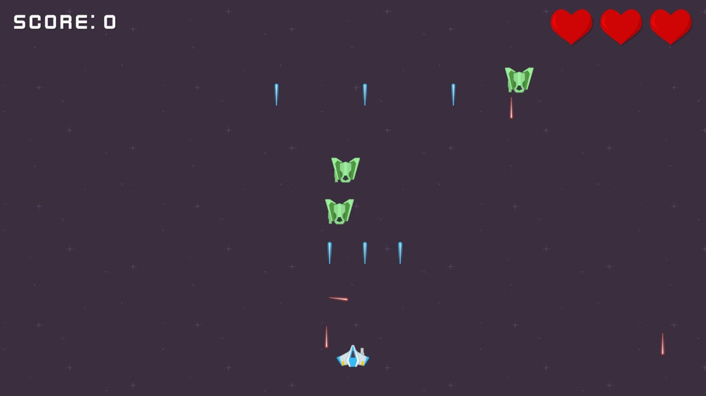
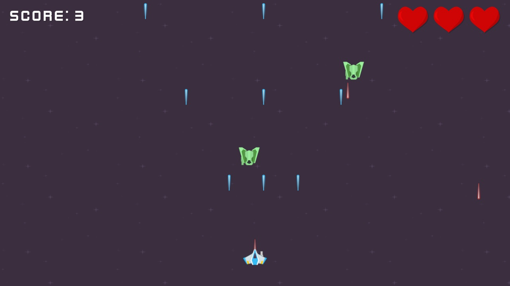
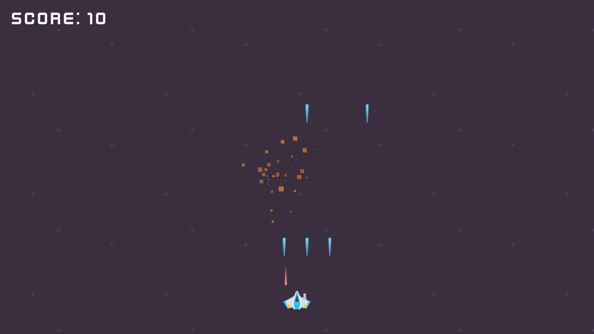
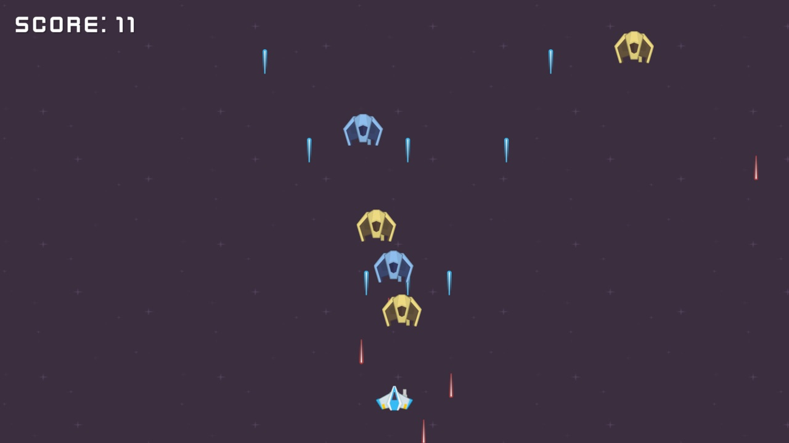

<!-- showcase-header -->

<h1>1947</h1>

<b>A 2D vertical space shooter: dodge, upgrade your guns and take down waves, formations and bosses.</b>

  

<a href="https://abhinandand91-debug.github.io/">Portfolio</a>

&nbsp;

&nbsp;

Captured from the game running in Unity.

## Highlights

- **Escalating waves:** Rookies, Fighters, Aces, then a boss with an enraged second phase, repeating tougher each round.
- **Weapon progression:** single, fast, double, triple spread and five-way; you lose a level whenever you are hit.
- **Enemy variety:** strafers, kamikaze chasers and V or line formations, with heart, shield and screen-clearing bomb pickups.
- **Game feel:** screen shake, hit flash, particle explosions, floating score popups, combo multiplier and synthesised sound effects.
- **Plays on desktop and mobile:** keyboard controls, or drag-to-steer with auto-fire on touch screens.

---

<!-- /showcase-header -->
## About this project

A 2D top-down space shooter built with Unity (2018.3).

- **Author:** Abhinandan Dharmadhikari
- **Created:** 2026-10-12

### Gameplay
Pilot your ship, dodge meteors, shoot down enemy ships and survive as long as you can.

### Opening the project
Open the project folder with Unity 2018.3.5f1 (or newer) and load `Assets/Scenes/MainScene.unity`.

### Features
- Screen shake, hit flash, particle explosions and floating score popups
- Synthesised sound effects (`python3 Tools/GenerateSfx.py` regenerates them)
- Saved best score and a game over screen with Retry
- Difficulty waves: Rookies (easy), Fighters (medium), Aces (hard), then a Boss, repeating tougher each round
- Difficulty selector (Easy / Normal / Hard) on the main menu
- Pickups dropped by enemies: heart, shield and screen-clearing bomb
- Boss health bar with a second "enraged" phase, and a bonus heart for beating a boss
- Enemy variety: strafers, kamikaze chasers and V / line formations
- Combo multiplier for chained kills
- Pause menu, vibration and optional manual fire button on mobile
- The player's gun upgrades as enemies are destroyed: single, fast, double, triple spread, five-way, and one level is lost whenever you are hit

### Controls
| Platform | Move | Shoot |
|----------|------|-------|
| Desktop  | Arrow keys / WASD | Space |
| Mobile   | Touch and drag anywhere, the ship follows your finger | Auto-fires while touching |

The game runs in landscape on Android and iOS.
